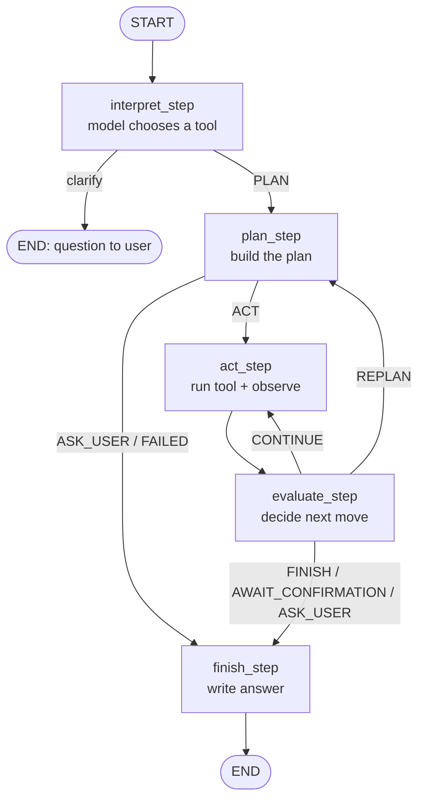

# 🍎 Fruit Store Agent

A local AI shopping assistant for a fruit store, built with **LangChain**, **LangGraph**, and **Ollama** (`qwen2.5:3b`).

The agent understands natural language orders, checks stock, calculates exact invoices, and can **replan** (reduce quantities) to fit your budget. All of this happens only when you allow it. The inventory changes only after you type `confirm order`.

---

## ✨ Features

- **Natural language orders**: *"I need 3 kg of apples and 2 kg of bananas."*
- **Tool calling**: the model picks one tool from a fixed list of tool schemas.
- **ReAct / Replan loop**: a LangGraph workflow plans, acts, observes, evaluates, and replans.
- **Budget-aware replanning**: a binary search finds the largest basket that fits your budget.
- **Exact money math**: `Decimal` is used everywhere, with `ROUND_HALF_UP` rounding to cents.
- **Safe confirmation**: orders are finalized only with the explicit `confirm order` command.
- **Safe file saving**: the inventory is written to a temporary file first, then replaces the real file.
- **Pounds to kilograms**: weights in lb are converted automatically (1 lb = 0.45359237 kg).
- **Plural names**: `apples`, `peaches`, and `strawberries` are matched to catalog names.
- **Runs fully local**: no API keys and no cloud services are needed.

---

## 📁 Project Structure

```
fruit-store-agent/
├── main.py          # Chat loop (entry point)
├── agent.py         # FruitAgent class and the LangGraph workflow
├── tools.py         # Tools, replanning helper, order confirmation, tool schemas
├── calculator.py    # Invoice calculation and money rounding
├── inventory.py     # Load, validate, and save the inventory
├── fruits.json      # Product catalog (prices and stock)
└── README.md
```

| File | Responsibility |
|---|---|
| `main.py` | Shows the welcome text and reads user messages in a loop |
| `agent.py` | Talks to the model, checks its answer, and runs the graph |
| `tools.py` | Runs store actions such as stock checks, totals, and confirmation |
| `calculator.py` | Builds invoices with exact `Decimal` math |
| `inventory.py` | Validates `fruits.json` and saves it safely |

---

## 🧰 Requirements

- Python **3.9+**
- [Ollama](https://ollama.com) installed and running
- The `qwen2.5:3b` model

---

## 🚀 Installation

**1. Clone the repository**

```bash
git clone https://github.com/<your-username>/fruit-store-agent.git
cd fruit-store-agent
```

**2. Create a virtual environment (recommended)**

```bash
python -m venv venv
source venv/bin/activate        # Windows: venv\Scripts\activate
```

**3. Install the Python packages**

```bash
pip install langchain-core langchain-ollama langgraph
```

You can also use a `requirements.txt` file:

```
langchain-core
langchain-ollama
langgraph
```

```bash
pip install -r requirements.txt
```

**4. Download the model**

```bash
ollama pull qwen2.5:3b
```

**5. Start the agent**

```bash
python main.py
```

---

## 💬 Usage

### Commands

| Command | Action |
|---|---|
| `confirm order` | Buys the pending quote and updates the inventory |
| `cancel order` | Discards the pending quote |
| `reset` | Clears the conversation memory and the pending order |
| `exit` / `quit` | Closes the program (`Ctrl+C` also works) |

Commands work with any letter case and extra spaces.

### Example Messages

```
What fruits do you have?
How much is a mango?
I need 2 kg of oranges and 1 kg of grapes.
I want 3 lb of strawberries.
I need 3 kg of apples and 2 kg of bananas. My budget is 5 USD. Reduce quantities if necessary.
```

### Example Session

```
You: I need 3 kg of apples and 2 kg of bananas. My budget is 5 USD. Reduce quantities if necessary.

Agent:
Invoice quote:
Quantities were reduced to fit the stock and budget.
- apple: 0.88 kg x 4.00 USD = 3.52 USD
- banana: 0.59 kg x 2.50 USD = 1.48 USD
Total: 5.00 USD
Inventory is unchanged until confirmation.
Type 'confirm order' to buy or 'cancel order' to discard.

You: confirm order

Agent:
Final invoice:
- apple: 0.88 kg x 4.00 USD = 3.52 USD
- banana: 0.59 kg x 2.50 USD = 1.48 USD
Total: 5.00 USD
Order confirmed. Inventory updated.
```

> **Note:** If you set a budget but do **not** allow smaller quantities, the agent will not reduce anything. It explains the problem and asks you to change the request instead.

---

## 🧠 How It Works

### The LangGraph Workflow



| Node | What it does |
|---|---|
| `interpret_step` | Sends the message, catalog, memory, and pending order to the model. The model calls **one** tool. |
| `plan_step` | Builds the list of items and steps. On a replan, `adjust_order_items` shrinks the basket. |
| `act_step` | Runs the current tool and saves the result (**Act + Observe**). |
| `evaluate_step` | Chooses `CONTINUE`, `REPLAN`, `ASK_USER`, `FINISH`, or `AWAIT_CONFIRMATION`. |
| `finish_step` | Writes the final answer and stores a new pending order if a quote succeeded. |

### Tools the Model Can Choose

| Tool schema | Intent | Steps that run |
|---|---|---|
| `list_inventory` | `inventory` | `list_inventory` |
| `get_product` | `product` | `get_product` |
| `quote_order` | `order` | `check_stock` → `calculate_total` → `prepare_invoice` |
| `ask_clarification` | `clarify` | none (the question is shown to the user) |

### The Replanning Algorithm

When the stock is too low or the total is above the budget, **and** the user allowed reductions, `adjust_order_items` does the following:

1. Keeps every requested fruit (at least 0.01 kg each).
2. Never gives more than requested or more than the stock.
3. Shrinks all fruits together, so the basket keeps its shape.
4. Uses a **binary search** to find the largest basket inside the budget.
5. Checks every candidate with the real invoice calculator.

If even 0.01 kg of each fruit is above the budget, the agent explains this and asks the user what to do.

---

## 🔒 Safety Rules

| Rule | How it is enforced |
|---|---|
| The model never calculates money | Totals come only from `calculator.py` |
| The model never reduces quantities | There is no schema for `adjust_order_items` |
| The model never confirms orders | There is no schema for `confirm_pending_order` |
| Orders need explicit confirmation | Only the `confirm order` command changes the inventory |
| Prices may change before confirmation | Stock, prices, currency, and budget are checked again at confirmation |
| Bad model output is rejected | Tool calls are validated against their schemas and retried |
| The file is never left half-written | It is saved with a temporary file and `os.replace` |

---

## 📦 Inventory Format

The file **must** be named `fruits.json` and placed next to `inventory.py`.

```json
{
  "currency": "USD",
  "quantity_unit": "kg",
  "products": [
    { "name": "apple",      "price_per_kg": "4.00", "stock_kg": "66.12" },
    { "name": "banana",     "price_per_kg": "2.50", "stock_kg": "75.18" },
    { "name": "orange",     "price_per_kg": "3.50", "stock_kg": "21" },
    { "name": "grape",      "price_per_kg": "6.00", "stock_kg": "5" },
    { "name": "pear",       "price_per_kg": "4.50", "stock_kg": "6" },
    { "name": "peach",      "price_per_kg": "5.00", "stock_kg": "4" },
    { "name": "kiwi",       "price_per_kg": "7.00", "stock_kg": "3" },
    { "name": "mango",      "price_per_kg": "8.00", "stock_kg": "4" },
    { "name": "pineapple",  "price_per_kg": "5.50", "stock_kg": "5" },
    { "name": "strawberry", "price_per_kg": "9.00", "stock_kg": "3" }
  ]
}
```

Validation rules:

- `currency` must be a non-empty string.
- `quantity_unit` must be `"kg"`.
- Product names must be unique (letter case is ignored).
- `price_per_kg` must be positive.
- `stock_kg` cannot be negative.

> Numbers are stored as **strings** so that `Decimal` keeps them exact.

---

## ⚙️ Configuration

You can change these constants in `agent.py`:

| Constant | Default | Meaning |
|---|---|---|
| `MODEL` | `"qwen2.5:3b"` | The Ollama model name |
| `MAX_MODEL_RETRIES` | `2` | Retries when the model sends a bad tool call |
| `MAX_PLAN_ATTEMPTS` | `4` | Maximum planning attempts per message |
| `MEMORY_MESSAGES` | `12` | Number of recent messages kept in memory |

To hide the debug logs (`[TOOL CALL]`, `[PLAN]`, `[ACT]`, ...), change this line in `main.py`:

```python
agent = FruitAgent(verbose=False)
```

---

## 🛠️ Troubleshooting

| Problem | Solution |
|---|---|
| `Connection refused` | Start Ollama with `ollama serve` |
| `model "qwen2.5:3b" not found` | Run `ollama pull qwen2.5:3b` |
| `FileNotFoundError: fruits.json` | Make sure the file is named `fruits.json` (not `fruit.json`) |
| `The model failed: ...` | The small model sent bad tool calls twice. Rephrase the message more clearly. |
| `Prices or currency changed` | The inventory changed after the quote. Ask for a new quote. |

---

## 🧪 Quick Test

```
I need 3 kg of apples and 2 kg of bananas. My budget is 5 USD. Reduce quantities if necessary.
```

With verbose mode on, you should see:

1. `[TOOL CALL]` → `quote_order`
2. `[EVALUATE]` → `Total 17.00 is above the budget of 5.` → `REPLAN`
3. `[REPLAN TOOL]` → `adjust_order_items`
4. A reduced invoice with a total of **5.00 USD** or less

---

## 📚 Tech Stack

- [LangChain](https://python.langchain.com/) for the model interface and tool binding
- [LangGraph](https://langchain-ai.github.io/langgraph/) for the stateful agent workflow
- [Ollama](https://ollama.com/) for running the local model
- [Qwen2.5 3B](https://ollama.com/library/qwen2.5) as the language model

---

## 📄 License

This project is licensed under the MIT License. You are free to use it for learning and teaching.
