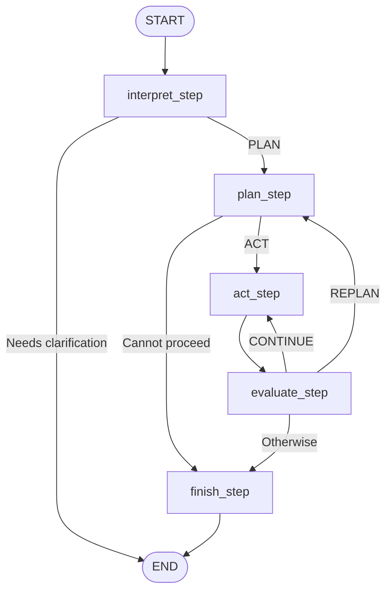

# Fruit Store Assistant 🍎

A fruit store assistant built with **Python**, **LangGraph**, and a local language model served through **Ollama**.

The assistant interprets customer requests, checks fruit availability, calculates order totals, and prepares invoice quotes. It can also revise a plan when stock or budget constraints require quantity adjustments.

> Orders are finalized only after the customer explicitly sends `confirm order`.

## Features

- Understand customer requests using a local language model.
- Manage fruit inventory with prices and available stock.
- Normalize fruit names before processing.
- Validate quantity and price inputs.
- Convert quantities from pounds to kilograms when needed.
- Check shopping baskets against available stock.
- Calculate invoice quotes with appropriate rounding.
- Replan orders when the customer allows quantity reductions.
- Load and save inventory data safely.
- Require explicit confirmation before finalizing an order.

## Technologies

| Technology | Purpose |
|---|---|
| Python | Application logic and inventory processing |
| LangGraph | Workflow orchestration, state management, and conditional routing |
| Ollama | Local language model server |
| `qwen2.5:3b` | Language model used to interpret requests |

## Inventory Conventions

- **Currency:** USD
- **Quantity unit:** kilograms
- **Fruit information:** name, price per kilogram, and stock in kilograms

Prices and stock must come from the inventory data. The assistant must not invent product prices or availability.

Quantities provided in pounds are converted to kilograms before inventory validation and price calculation.

## How It Works

The application separates language understanding from inventory and order calculations.

1. **Interpret the request**  
   Identify the customer’s intent, requested fruits, quantities, and relevant constraints.

2. **Create a plan**  
   Decide which tools should run and in what order.

3. **Execute a tool**  
   Perform the current operation, such as checking stock or calculating a total.

4. **Evaluate the result**  
   Decide whether to continue, revise the plan, or finish.

5. **Respond to the customer**  
   Present the result, explain a problem, or ask for order confirmation.

## LangGraph Architecture

The workflow contains five LangGraph nodes:

| Node | Responsibility |
|---|---|
| `interpret_step` | Interpret the customer’s request |
| `plan_step` | Create or revise the execution plan |
| `act_step` | Execute the current tool |
| `evaluate_step` | Evaluate the tool result and choose the next action |
| `finish_step` | Prepare the final response for the current graph run |

### Workflow Diagram



### Nodes Are Not the Same as Tools

The following operations are tools executed inside `act_step`:

- `check_stock`
- `calculate_total`
- `prepare_invoice`

They are **not separate LangGraph nodes**.

For example, an order plan may contain:

```python
["check_stock", "calculate_total", "prepare_invoice"]
```

The graph visits `act_step` repeatedly, executing one tool on each visit.

## Workflow Loops

The workflow supports both continued execution and replanning.

### 1. Continue to the Next Tool

```text
act_step → evaluate_step → act_step
```

When the evaluator returns `CONTINUE`, the application advances the step index and executes the next tool.

A successful quote workflow follows this sequence:

```text
act_step: check_stock
    ↓
evaluate_step: CONTINUE
    ↓
act_step: calculate_total
    ↓
evaluate_step: CONTINUE
    ↓
act_step: prepare_invoice
    ↓
evaluate_step: AWAIT_CONFIRMATION
    ↓
finish_step
```

### 2. Revise the Plan

```text
plan_step → act_step → evaluate_step → plan_step
```

When the evaluator returns `REPLAN`, execution returns to the planning node.

Replanning can occur when:

- The requested quantity exceeds available stock.
- The calculated total exceeds the customer’s budget.
- The customer has allowed quantity reductions.

The revised basket is checked again before the workflow proceeds.

If quantity reductions are not allowed, the assistant should explain the constraint rather than silently change the order.

### Conditional Routing

The evaluation routing follows this pattern:

```python
def route_after_evaluate(self, state):
    if state["decision"] == "CONTINUE":
        return "act_step"

    if state["decision"] == "REPLAN":
        return "plan_step"

    return "finish_step"
```

This routing preserves the assistant’s ability to react to tool results and revise its plan.

## Order Confirmation

Preparing an invoice quote does **not** finalize an order.

The customer must explicitly send:

```text
confirm order
```

The confirmation requirement keeps quote preparation separate from order finalization.

> Reaching `END` means the current graph run has finished. It does not necessarily mean an order has been confirmed.

## Validation and Reliability

The application includes validation for inventory and order processing:

- Fruit names are normalized before lookup.
- Numeric inputs are validated before calculation.
- Requested quantities are checked against available stock.
- Prices are read from inventory data.
- Monetary calculations use decimal handling and appropriate rounding.
- Inventory loading and saving include safeguards.

## Getting Started

### Prerequisites

- Python compatible with the project’s dependencies
- Ollama installed locally
- The project’s Python dependencies
- A valid inventory file in the format expected by the application

### 1. Clone the Repository

Replace the placeholders with your GitHub username and repository name:

```bash
git clone https://github.com/<your-username>/<repository-name>.git
cd <repository-name>
```

### 2. Create a Virtual Environment

```bash
python -m venv .venv
```

Activate it on macOS or Linux:

```bash
source .venv/bin/activate
```

Activate it on Windows PowerShell:

```powershell
.venv\Scripts\Activate.ps1
```

### 3. Install Dependencies

If the repository provides a `requirements.txt` file:

```bash
pip install -r requirements.txt
```

Otherwise, install dependencies using the dependency configuration included in the project.

### 4. Download the Local Model

```bash
ollama pull qwen2.5:3b
```

### 5. Start Ollama

If Ollama is not already running:

```bash
ollama serve
```

### 6. Configure the Application

Check the application’s configuration for:

- Ollama API connection settings
- Model name: `qwen2.5:3b`
- Inventory file location

### 7. Run the Application

Run the Python entry-point file included in the repository:

```bash
python <entry-point-file>.py
```

Replace `<entry-point-file>` with the actual application filename.

## Example Requests

### Request an Order Quote

```text
I would like 2 kg of apples and 1 kg of bananas.
```

The assistant checks stock, calculates the total, and prepares a quote using inventory prices.

### Allow Quantity Adjustments

```text
I would like 5 kg of apples. You may reduce the quantity if there is not enough stock.
```

The assistant can revise the basket when the requested quantity is unavailable.

### Set a Budget

```text
I want apples and bananas with a maximum budget of $15.
You may reduce the quantities to stay within my budget.
```

The assistant can replan if the calculated total exceeds the budget.

### Use Pounds

```text
I would like 2 pounds of apples.
```

The application converts the quantity to kilograms before processing.

### Confirm an Order

```text
confirm order
```

## Notes for Beginner Students

This project demonstrates several important concepts:

- **State:** Information passed between workflow nodes.
- **Node:** A function responsible for one stage of the workflow.
- **Tool:** A specific operation executed by the action node.
- **Conditional edge:** A connection selected according to the current state.
- **Loop:** A route that returns execution to a previously visited node.
- **Replanning:** Revising a plan after evaluating a result.

The key idea is that the workflow is not just a fixed sequence. It can continue executing tools or return to planning when new information requires an adjustment.

## Project Rules

1. Respond in English.
2. Use inventory data for prices and stock.
3. Validate quantities before processing an order.
4. Respect stock and budget constraints.
5. Reduce quantities only when the customer allows it.
6. Require the explicit `confirm order` command before finalizing an order.
